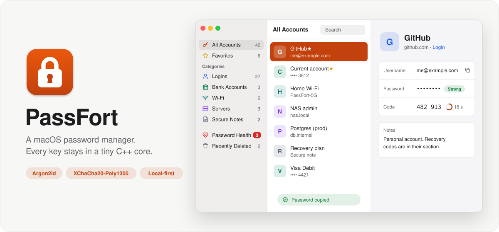

# PassFort

<picture>
  <source media="(prefers-color-scheme: dark)" srcset="docs/images/hero-dark.svg">
  
</picture>

[](https://github.com/csabimvp/PassFortApp/actions/workflows/ci.yml)

A local-first password manager for macOS. Your vault is one encrypted file on your Mac, and the
app works without an account or a network connection.

Status: personal project, in active development. There is no packaged release yet, so you build
and install the app from source. Sync between devices is being built (milestone M5) and isn't in the
app yet.

## Features

- Accounts with usernames, passwords, URLs, notes and custom fields. Search, favourites, categories
  and password history.
- One-time codes (TOTP), added from the secret or by reading a QR code.
- A password generator for random passwords or EFF-wordlist passphrases.
- Password health: weak, reused, old and expiring passwords, and plain `http://` logins.
- Quick Access: press ⌃⌥Space in any app, search, and press Return to copy the password. Clipboard
  managers don't see the copy, and it's cleared after 20 seconds or on lock.
- Auto-lock when idle, on sleep and on screen lock.
- Backups to a folder you choose, with retention, optionally on every lock.
- Import from a Password Safe plain-text export or from another PassFort vault. Plaintext export
  from the CLI.
- A recovery key for a forgotten master password, and Recently Deleted for removed accounts.
- `passfort-cli`, a command-line client for the same vault format.

## Requirements

- macOS 26.5 or later on Apple silicon
- Xcode 26.6
- An Apple ID signed in to Xcode (a free one is enough) to sign the build

## Installation

1. Clone the repository:

   ```bash
   git clone https://github.com/csabimvp/PassFortApp.git && cd PassFortApp
   ```

2. Find your development team ID. It is the `OU` field of your Apple Development certificate. If
   you don't have the certificate yet, open Xcode, go to Settings > Accounts, select your Apple ID
   and click Manage Certificates.

   ```bash
   security find-certificate -c "Apple Development" -p | openssl x509 -noout -subject
   ```

3. Build and install. The script makes a Release build, signs it with your team and copies it to
   `/Applications/PassFort.app`. The first build takes a few minutes, mostly compiling the crypto
   library.

   ```bash
   DEVELOPMENT_TEAM=ABCDE12345 scripts/install_app.sh
   ```

   Replace `ABCDE12345` with your team ID. To update later, `git pull` and run the same command.
   Your vault lives in the app's sandbox container, so reinstalling doesn't touch it.

## Usage

On first launch, create a vault and choose a master password. The app then shows a recovery key
once. Store it somewhere safe and offline: it is the only way back in if you forget the master
password.

- **Backups.** In Settings, choose a backup folder (a NAS share works well) and how many backups
  to keep. Backups are encrypted like the vault and verified after each write.
- **Moving to another Mac.** Copy a backup over and use Restore from Backup on the new Mac. The
  vault it replaces is kept as a safety copy, never deleted.
- **Leaving.** `passfort-cli export` writes a whole vault as plaintext JSON after you type a
  confirmation phrase. Delete the file once you've imported it elsewhere.

The CLI works on the same vault format:

```bash
cd Packages/PassFortKit
swift run passfort-cli init  vault.sqlite
swift run passfort-cli add   vault.sqlite --title github --username me --prompt-password
swift run passfort-cli get   vault.sqlite github
```

Every command is listed in [`docs/development.md`](docs/development.md#the-cli).

## Security

Everything in the vault is encrypted, including titles, usernames and URLs. The key comes from your
master password through Argon2id, and each record is sealed with XChaCha20-Poly1305. A manifest MAC
detects records that were deleted or swapped and a vault file that was rolled back. Sync, when it
arrives, is end-to-end encrypted and treats the server as hostile.

PassFort has not been independently audited. The threat model, including what it does not defend
against, is in [`docs/architecture.md` §3](docs/architecture.md#3-threat-model). To report a
vulnerability, see [`SECURITY.md`](SECURITY.md).

## Architecture

The app is a SwiftUI shell over a local Swift package, `PassFortKit`:

| Module | Language | Role |
|---|---|---|
| `PFCrypto` | C++ (Botan 3) | Holds every key and never hands one out: key derivation, record sealing, the vault header, the manifest MAC |
| `PassFortCrypto` | Swift | The only module that talks to C++; wraps it in an `actor VaultSession` |
| `PassFortVault` | Swift | Storage in SQLite (GRDB), the data model, migrations, import and export, the sync client |
| `PassFort` | Swift | The macOS app |

The rule that shapes the design: keys stay in C++, and Swift can only ask the session to seal or
open bytes. [`docs/architecture.md`](docs/architecture.md) is the full specification, and
[`docs/adr/`](docs/adr/) records the reasoning behind each major decision. The sync contract is in
[`SyncAPI/`](SyncAPI/).

The code was written by an AI coding agent ([Claude Code](https://claude.com/claude-code)) against
the maintainer's specification and phased build plans ([`docs/runbooks/`](docs/runbooks/)).

## Development

Building, testing and the full CLI reference are in [`docs/development.md`](docs/development.md).
The quick loop:

```bash
cd Packages/PassFortKit && swift build && swift test
xcodebuild test -scheme PassFort -destination 'platform=macOS'
```

## License

MIT, see [`LICENSE`](LICENSE). Bundled third-party code keeps its own license: Botan (BSD-2-Clause,
`Packages/PassFortKit/Sources/PFCrypto/vendor/botan/license.txt`) and the EFF large wordlist
(CC BY 3.0 US). GRDB (MIT) and swift-argument-parser (Apache-2.0) are fetched by SwiftPM.
